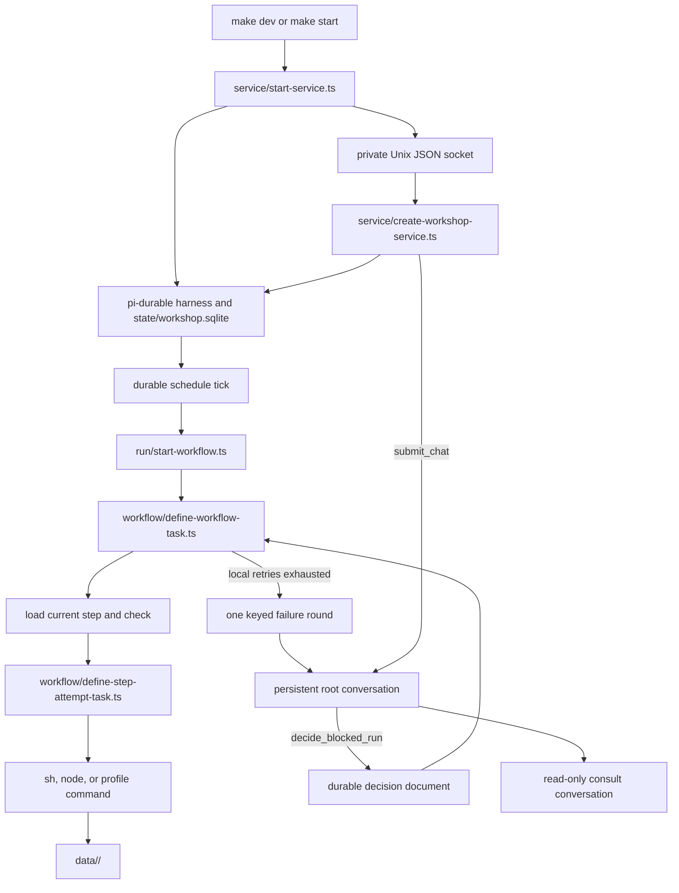

# Contributing

These rules keep the codebase easy to navigate and easy to delete from. The
first sections apply to any project; the last two sections record choices specific
to this one and how its code works.

## Naming files

A reader should know what a file does from its path alone, before opening it.

### Folders are nouns, files are verbs

- **Folders** name the domain things the code is about: `config/`, `workflow/`, `run/`, `schedule/`, and `service/`. Use the same nouns as the data model and user-facing terms.
- **Files** lead with a verb that says what they do: `workflow/load-workflows.ts`,
  `workflow/execute-workflow-attempt.ts`, `service/serve-service-socket.ts`. A noun
  alone, such as `workflow/types.ts`, says what a file is about, not what it does.
- **Exception: pure shape.** A file that only declares types or a schema keeps a noun name, such as `workflow/types.ts`.

### Use one verb per kind of work

Give each verb one meaning and reuse it for that meaning:

| Verb | Means | Example |
| --- | --- | --- |
| `parse` | turn text into structure | `workflow/parse-workflow-decision.ts` |
| `check` | apply fixed rules and report errors | `scripts/check-workflows.ts` |
| `load` | read a file and return checked data | `workflow/load-workflows.ts`, `workflow/load-workflow-step.ts` |
| `build` | assemble input for another program | `workflow/build-orchestrator-brief.ts` |
| `create` | assemble an in-process component | `service/create-workshop-service.ts` |
| `define` | register a durable task | `workflow/define-workflow-task.ts` |
| `execute` | carry out a unit of work | `run/execute-workflow-process.ts` |
| `open` | initialize a durable harness | `service/open-workshop-harness.ts` |
| `serve` | expose the local JSON API | `service/serve-service-socket.ts` |

Other plain verbs (`start`, `send`, `cancel`, `pause`, `resume`) are fine when no verb above already covers the job. Before adding a verb, check that it does not overlap one in the table; if it will recur, add it to the table.

### Rules that prevent collisions

- **Never use "run" as a verb.** In this project, a `run` is one workflow
  execution. Use `execute`, `advance`, `start`, or a more specific verb
  instead.
- **Use `parse` and `check` for different jobs.** Parsing turns input into
  structure. Checking applies fixed rules and reports errors.
- **Use the project's domain words.** Authors and code both call these items
  steps (`WorkflowStep`), not nodes.
- **Name the logic, not the area.** Use a specific, verb-first name that
  describes the file's main action.
- **Match exported symbols to the file's verb.**
  `workflow/load-workflows.ts` exports `loadWorkflows`;
  `run/start-workflow.ts` exports `startWorkflow`.
- **Split a file when its name needs "and".** Combine two steps only when they
  always happen together. Give independent steps their own files.

## Code

- **Optimize for deletion.** Keep behavior local. Prefer a small duplicated helper over a shared abstraction that couples two features.
- **Point dependencies one way.** Entry points depend on domain folders, and domain folders depend on storage and utilities. Never the reverse. When a rule matters, write a test that reads the import graph and fails on a violation.
- **Comment the why.** Explain non-obvious reasons and constraints. Do not narrate what the next line does.
- **Test behavior that could regress.** Test what the code promises: its outputs, state transitions, and error cases. Do not test how it is built.

## Changes

- Keep each change small and about one thing. A rename and a behavior change belong in separate commits.
- Write commit subjects that say what changed and why; put the reasoning a reviewer needs in the body.
- Run the typecheck and tests before asking for review.

## This project

- A **workflow** is a folder of settings and ordered steps. A **run** is one execution of that workflow. A **step** is a command or an agent operation.
- pi-durable owns durable workflow tasks and the persistent orchestrator conversation. Workshop loads workflow folders, interprets steps, starts scheduled work, and supplies the orchestrator tools.
- `make check` validates local config and workflow folders, typechecks the project, and runs its tests.
- Before review, run:

  ```fish
  npx tsc --noEmit
  npm test
  make check
  ```

- [Code map](#code-map) describes the folders and their boundaries; update it when you add or move a file.

## How the code works

Workshop is a Node.js and TypeScript service built on pi-durable. `make start`
runs `service/start-service.ts`; `make dev` runs it in Node watch mode. Startup
validates config and workflows, claims the SQLite owner row, opens the durable
harness, and listens on a private Unix socket. It resolves the root and consult
models through Pi's registry and auth store. The harness keeps the root
orchestrator conversation and durable workflow tasks in SQLite. A durable tick
task checks schedules once a minute.

A workflow admission creates a `WorkflowTask` with its validated settings and
ordered steps. The task reads each step and check file when that step starts,
then creates a `StepAttemptTask` to do the work. Checkpoints keep the pipe
input, step results, attempts, retry state, and blocked decisions. Run-reference
documents map public run IDs to durable task IDs. The session document keeps
recent admissions, actions, and decision receipts, plus scheduling counters.
A hard service crash can replay an unfinished command, and its original child
process may still be running. Make external effects safe to repeat.

After local retries fail, the workflow task submits one keyed failure round to
the root conversation. The root can decide through Workshop tools or call
`consult`, a read-only child conversation using the escalation model. If the
round takes no safe action, Workshop records `give_up` and leaves the run
blocked. `make chat` attaches to the same persistent root over the socket and
streams text and tool progress. Submissions queue behind an active turn.

The daily-summary example reads recent runs and actions through the service
API. Workflow steps share `data/<workflow>/`, separate from SQLite state.
Commands and profile processes use the service account's permissions; they
are not sandboxed.



### Code map

Folders and filenames follow [Naming files](#naming-files).

```text
agent/instructions.md                     root orchestrator instructions
config/                                   config loading and validation
  check-profile-commands.ts              executable lookup for configured profiles
  load-workshop-config.ts                 YAML, environment, and profile-schema validation
service/                                  durable service and local API
  acquire-store-lock.ts                   single-owner SQLite lock
  cancel-workflow-run.ts                   run cancellation and recovery
  create-orchestrator-runtime.ts           Pi model registry and auth
  read-service-failure-code.ts           stable mutation failure codes
  create-workshop-chat.ts                  root conversation chat lifecycle
  create-workshop-extension.ts             root tools, status, and consult
  create-workshop-service.ts               request routing and receipt gate
  decide-blocked-run.ts                    blocked decision validation and receipt
  launch-service.plist.template            macOS service launch settings
  open-workshop-harness.ts                 durable task and conversation registry
  project-chat-events.ts                   chat event state projection
  project-workflow-run-status.ts          run status and capability projection
  read-workshop-status.ts                  workflow and run reads
  record-service-receipt.ts                mutation receipt replay and storage
  request-service.ts                       local API client
  resolve-failure-round.ts                 automatic-round decision binding
  serve-service-socket.ts                  private JSON socket
  set-workflow-pause.ts                    pause and resume state changes
  start-service.ts                         entrypoint and lifecycle
  tick-workflows.ts                        workflow tick execution and task registration
  parse-service-request.ts               service request schema, parser, and response shapes
workflow/                                 workflow loading and durable execution
  accept-blocked-decision.ts               blocked decision acceptance rules
  advance-workflow-state.ts                checkpoint validation and transitions
  apply-workflow-decision.ts               blocked-run decision rules
  build-orchestrator-brief.ts              failure-round prompt
  compute-retry-profiles.ts                allowed retry profiles
  define-step-attempt-task.ts              durable step-attempt task
  define-workflow-task.ts                  durable workflow task
  define-workshop-state.ts                 durable workshop state and history
  execute-workflow-attempt.ts              step and check attempt execution
  list-workflow-status.ts                  workflow status for orchestrator tools
  load-workflow-step.ts                    step and check files at step start
  load-workflows.ts                        folder validation and workflow loading
  parse-workflow-decision.ts               decision validation
  parse-workflow-duration.ts               duration grammar and timer limits
  types.ts                                 workflow, step, and decision request shapes
run/                                      admission and process execution
  decide-workflow-admission.ts             start receipt and admission decisions
  execute-workflow-process.ts              command and profile process groups
  start-workflow.ts                        workflow admission and task creation
  transition-workflow-pause.ts              idempotent pause and resume transitions
schedule/                                 cron-slot selection
  decide-workflow-slot.ts                  slot and `max_runs` decisions
scripts/                                  checks and user-facing commands
  check-config.ts                          local config and profile checks
  check-workflows.ts                       workflow and example checks
  chat-workshop.ts                         socket chat client
  copy-workshop.ts                         private copy setup
  install-launch-agent.ts                  macOS LaunchAgent installer
  read-workshop-activity.ts                activity reader for daily-summary
  uninstall-launch-agent.ts                macOS LaunchAgent remover
test/                                     unit and integration tests
  accept-blocked-decision.test.ts          blocked decision transition outcomes
  advance-workflow-state.test.ts           durable workflow transition outcomes
  admit-workflow.test.ts                   workflow admission side effects
  chat-workshop.test.ts                    interactive and single-reply chat
  check-architecture-boundaries.test.ts    dependency direction
  check-setup-scripts.test.ts              setup failure recovery output
  check-workflows.test.ts                  workflow validation
  crash-resume.test.ts                     SQLite task recovery
  decide-workflow-admission.test.ts        start receipt and admission outcomes
  execute-workflow-attempt.test.ts         command, agent, and check behavior
  load-workflows.test.ts                   workflow folder loading
  open-workshop-harness.test.ts             service resource lifecycle
  orchestrate-workflow.test.ts             step attempts and decisions
  parse-workflow-duration.test.ts          duration grammar and timer limits
  project-chat-events.test.ts               ordered chat event projection
  project-workshop-status.test.ts          run status and capability projection
  read-config.test.ts                      config and profile checks
  service-socket.test.ts                   socket behavior
  service.test.ts                          service operations and chat
  transition-service-lifecycle.test.ts      startup and shutdown transitions
  transition-workflow-pause.test.ts         idempotent pause and resume outcomes
examples/workflows/                       hemingway-clock and daily-summary
workflows/                                private workflows; upstream keeps .gitkeep only
workshop.example.yaml                     public config template
Makefile                                 setup, validation, service, chat, and copy targets
```

`workflow/` does not depend on the service API. The service composes config,
workflow, run, and schedule behavior around the durable harness. Tests use
fake commands and do not need model credentials.

### Tests and validation

`npm test` runs the Node test suite in `test/`, including an SQLite crash-resume
test that verifies the same parent and child task IDs resume. `make check`
validates config, profile executables, private workflows, and examples, then
runs the typecheck and tests. Before review, run:

```fish
npx tsc --noEmit
npm test
make check
```
