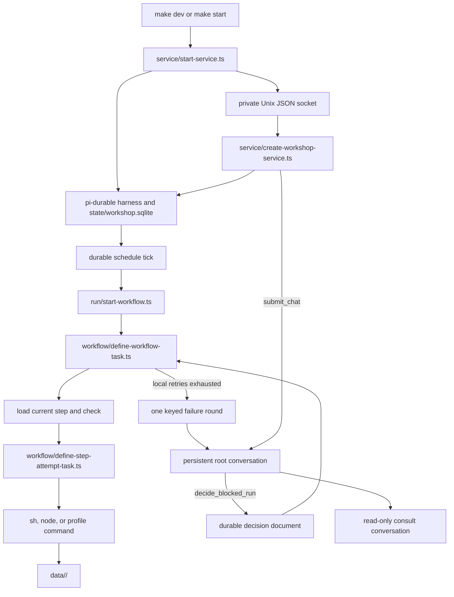

# Contributing

These rules keep the codebase easy to navigate and easy to delete from. The
first sections apply to any project; the last two sections record choices specific
to this one and how its code works.

## Naming files

A reader should know what a file does from its path alone, before opening it.

### Folders are nouns, files are verbs

- **Folders** name the domain things the code is about: `config/`, `workflow/`, `run/`, `schedule/`, and `service/`. Use the same nouns as the data model and user-facing terms.
- **Files** lead with a verb that says what they do: `workflow/load-workflows.ts`, `workflow/interpret-workflow.ts`, `service/serve-service-socket.ts`. A noun alone (`types.ts`) says what a file is about, not what it does.
- **Exception: pure shape.** A file that only declares types or a schema keeps a noun name, such as `workflow/types.ts` or `service/types.ts`.

### Use one verb per kind of work

Give each verb one meaning and reuse it for that meaning:

| Verb | Means | Example |
| --- | --- | --- |
| `parse` | turn text into structure | `workflow/parse-workflow-decision.ts` |
| `check` | apply fixed rules and report errors | `scripts/check-workflows.ts` |
| `load` | read a file and return checked data | `workflow/load-workflows.ts` |
| `build` | assemble input for another program | `workflow/build-orchestrator-brief.ts` |
| `create` | assemble an in-process component | `service/create-workshop-service.ts` |
| `define` | register a durable task | `workflow/define-workflow-task.ts` |
| `execute` | carry out a unit of work | `run/execute-workflow-process.ts` |
| `load` | read a file and return checked data | `workflow/load-workflow-step.ts` |
| `open` | initialize a durable harness | `service/open-workshop-harness.ts` |
| `serve` | expose the local JSON API | `service/serve-service-socket.ts` |

Other plain verbs (`start`, `send`, `cancel`, `pause`, `resume`) are fine when no verb above already covers the job. Before adding a verb, check that it does not overlap one in the table; if it will recur, add it to the table.

### Rules that prevent collisions

- **Never use "run" as a verb.** In a workflow runner, `run` names one execution. A function named `runWorkflow` or a file named `run-paths.ts` forces the reader to guess which meaning you meant. Use `execute`, `advance`, `start`, or a more specific verb.
- **Use `parse` and `check` for different jobs.** Parsing turns input into structure. Checking applies fixed rules and reports errors.
- **Use the project's domain words.** Authors and code both call these items steps (`WorkflowStep`), not nodes.
- **Name the logic, not the area.** `run/read-run-index.ts` says what it reads; a broad name like `run/state.ts` does not.
- **Match exported symbols to the file's verb.** `workflow/load-workflows.ts` exports `loadWorkflows`; `run/locate-blocked-step.ts` exports `locateBlockedStep`.
- **Split a file when its name needs "and".** `read-and-remove.ts` is the ceiling: two steps that always happen together. Three verbs means three files.

## Code

- **Optimize for deletion.** Keep behavior local. Prefer a small duplicated helper over a shared abstraction that couples two features.
- **Point dependencies one way.** Entry points depend on domain folders, and domain folders depend on storage and utilities. Never the reverse. When a rule matters, write a test that reads the import graph and fails on a violation.
- **Comment the why.** Explain non-obvious reasons and constraints. Do not narrate what the next line does.
- **Test behavior that could regress.** Test what the code promises: its outputs, state transitions, and error cases. Do not test how it is built.

## Changes

- Keep each change small and about one thing. A rename and a behavior change belong in separate commits.
- Write commit subjects that say what changed and why; put the reasoning a reviewer needs in the body.
- Run the typecheck and tests before asking for review.

## This project

- A **workflow** is a folder of settings and ordered steps. A **run** is one execution of that workflow. A **step** is a command or an agent operation.
- pi-durable owns durable workflow tasks and the persistent orchestrator conversation. Workshop loads workflow folders, interprets steps, starts scheduled work, and supplies the orchestrator tools.
- `make check` validates local config and workflow folders, typechecks the project, and runs its tests.
- Before review, run:

  ```fish
  npx tsc --noEmit
  npm test
  make check
  ```

- [Code map](#code-map) describes the folders and their boundaries; update it when you add or move a file.

## How the code works

## How the code works

Workshop is a Node.js and TypeScript service built on pi-durable. `make start` runs `service/start-service.ts`; `make dev` watches source files and restarts the service. Startup validates config and workflows, claims the SQLite owner row before task recovery, resolves orchestrator models through Pi's registry and auth store, opens the harness, and listens on a private Unix socket. The harness keeps one root conversation in SQLite for client chat and automatic failure rounds. A durable tick task checks schedules once a minute.

`WorkflowTask` stores the validated workflow settings and ordered step list. It reads each step and check file when that step starts, then creates a `StepAttemptTask` for the work. The task checkpoint stores pipe input, results, attempts, retry state, and blocked decisions. Run-reference documents map public run IDs to durable task IDs. A bounded session document keeps recent admission, action, and decision-receipt history plus per-workflow schedule counters. A hard service crash can replay an unfinished command; external effects must be safe to repeat. Workshop does not write run snapshots or separate run-state files.

After local retries fail, the workflow task saves the evidence and submits one keyed failure round to the root conversation. The root can decide through Workshop tools or call `consult`, a read-only child conversation using the escalation model. If it takes no safe action, Workshop records `give_up` and leaves the run blocked. A future chat client can send `submit_chat` through the private socket; `make chat` remains a placeholder.

The daily-summary example reads recent runs and actions through this service API. Steps still share `data/<workflow>/`, which is separate from the SQLite record. Commands and profile processes run with the service account's permissions. They are not sandboxed.



### Code map

Folders and filenames follow [Naming files](#naming-files).

```text
agent/instructions.md            root orchestrator instructions
config/                          config loading and validation
run/                             durable workflow admission, state, process execution
schedule/                        cron-slot selection and durable schedule ticks
service/                         Pi model runtime, root extension, harness, socket API, service entrypoint
workflow/                        parsing, step loading, decisions, durable task definitions
scripts/                         checks, activity reader, chat placeholder, copy, launch-agent setup
test/                            unit, service, socket, and SQLite resume tests
examples/workflows/              hemingway-clock and daily-summary folders
workflows/                       private workflows; upstream keeps .gitkeep only
workshop.example.yaml            config template
workshop.yaml                    local config, ignored upstream
Makefile                         setup, checks, service, chat, and copy commands
```

`workflow/` does not depend on the service API. `run/` and `schedule/` use the durable store through the service harness. Tests use fake commands and do not need model credentials.

### Tests and validation

`npm test` runs the Node test suite in `test/`. It includes an SQLite crash-resume test that verifies the same parent and child task IDs resume. `make check` validates config and workflows, then runs the typecheck and tests.
