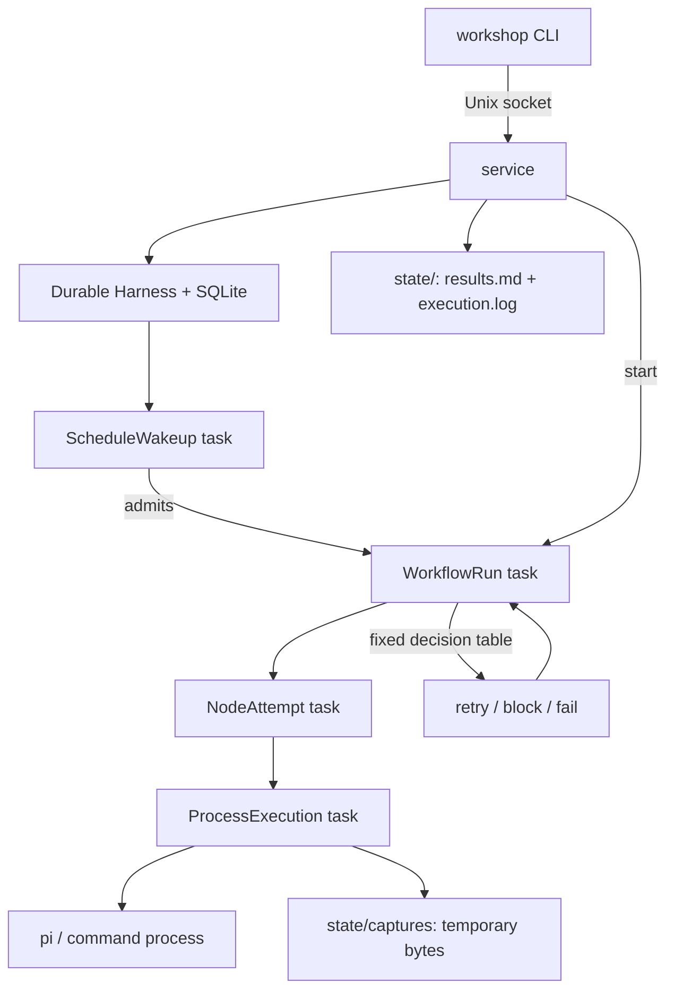

# Contributing

These rules keep the codebase easy to navigate and easy to delete from. The
first sections apply to any project; the last two sections record choices specific
to this one and how its code works.

## Naming files

A reader should know what a file does from its path alone, before opening it.

### Folders are nouns, files are verbs

- **Folders** name the domain things the code is about: `definition/`, `run/`,
  `attempt/`, `storage/`. Pick the nouns your data model already uses (table
  names, directory names, words in the UI) so one word means one thing
  everywhere.
- **Files** lead with a verb that says what the file does to that thing:
  `run/create-run.ts`, `attempt/judge-output.ts`, `storage/disk/lock-run.ts`.
  A noun alone (`packet.ts`, `utils.ts`, `helpers.ts`) says what a file is
  about, not what it does, and invites unrelated code to pile in.
- **Exception: pure shape.** A file that only declares types, a schema, or an
  interface keeps a noun name: `schema.ts`, `types.ts`, `data-source.ts`.
  So does an entrypoint (`main.ts`) and a file named after the command it
  implements (`cli/watch.ts`).

### Use one verb per kind of work

Each verb below has one meaning. Reuse it for that meaning, and never borrow it
for another.

| Verb | Means | Example |
| --- | --- | --- |
| `parse` | turn text into structure | `parse-yaml.ts`, `parse-units.ts` |
| `check` | apply a fixed rule; pass or throw, no judgment | `check-chain.ts`, `check-packet.ts` |
| `judge` | ask an agent or command whether output is good enough | `judge-output.ts` |
| `resolve` | combine layered settings into one value | `resolve-node-settings.ts` |
| `load` | read a file and return checked data | `load-definition.ts` |
| `build` | assemble data for another program to consume | `build-status-json.ts` |
| `render` | produce text for a person or an agent to read | `render-agent-prompt.ts` |
| `locate` | compute a path without touching disk | `locate-run-files.ts` |
| `create` | add a new record | `create-run.ts` |
| `execute` | carry out one unit of work to its end | `execute-attempt.ts` |
| `recover` | repair state left behind by a crash | `recover-after-crash.ts` |

Other plain verbs (`launch`, `merge`, `verify`, `format`) are fine when no verb
above already covers the job. Before adding a verb, check that it does not
overlap one in the table; if it will recur, add it to the table.

### Rules that prevent collisions

- **Never use "run" as a verb.** In a workflow runner, "run" is the most
  important noun. A function named `runChain` or a file named `run-paths.ts`
  forces the reader to guess which meaning you meant. Use `execute`, `advance`,
  `launch`, or a more specific verb.
- **Never use "validate" for two things.** The user-facing step `verify` is
  called a validator in code. Code that applies fixed rules says `check`, and
  code that invokes a validator says `judge`.
- **Steps are nodes in code.** Authors write `steps:`; the frozen definition,
  records, and tasks call them nodes (`NodeAttempt`, `nodeId`).
- **Name the logic, not the area.** `run-paths.ts` leaves open whether the
  file builds, checks, or cleans paths. `locate-run-files.ts` does not.
- **Match exported symbols to the file's verb.** `judge-output.ts` exports
  `judgeOutput`; `locate-run-files.ts` exports `locateWorklog`.
- **Split a file when its name needs "and".** `open-and-migrate.ts` is the
  ceiling: two steps that always happen together. Three verbs means three files.

## Code

- **Optimize for deletion.** Keep behavior local. Prefer a small duplicated
  helper over a shared abstraction that couples two features.
- **Point dependencies one way.** Entry points depend on domain folders, and
  domain folders depend on storage and utilities. Never the reverse. When a
  rule matters, write a test that reads the import graph and fails on a
  violation.
- **Comment the why.** Explain non-obvious reasons and constraints. Do not
  narrate what the next line does.
- **Test behavior that could regress.** Test what the code promises: its
  outputs, state transitions, and error cases. Do not test how it is built.

## Changes

- Keep each change small and about one thing. A rename and a behavior change
  belong in separate commits.
- Write commit subjects that say what changed and why; put the reasoning a
  reviewer needs in the body.
- Run the typecheck and tests before asking for review.

## This project

- Domain nouns: **workflow** (the YAML definition), **run** (one occurrence of
  a workflow), **attempt** (one try at one node). These match the stored
  records and workflow-owned projection files.
- The `service` owns runs. A step-local verifier checks results and can request
  a retry or block. Fixed rules decide failure and retry transitions.
- Checks before review:

  ```bash
  bunx tsc --noEmit
  bun test
  ```

- [Code map](#code-map) describes the folders and their boundaries; update it
  when you add or move a file.

## How the code works

Workshop is a local service with a thin CLI. The CLI sends every command over a
private Unix socket. The service owns a Pi Durable Harness: a task runner that
commits each step's progress to SQLite before taking the next one. Every run is
a small tree of Durable tasks, so after a crash the service resumes from the
last commit instead of guessing.



### One run

The task tree for one run, in `src/storage/durable/`:

```text
WorkflowRun                                define-workshop-tasks.ts
  preflight → ProcessExecution
  for each step (node) in the frozen chain:
    NodeAttempt                            define-node-attempt-task.ts
      build process stdin                  attempt/build-process-stdin.ts
      worker    → ProcessExecution         define-process-execution-task.ts
      parse stdout by frozen result mode
      validator → ProcessExecution
    if the attempt failed:
      fixed decision table                 define-workshop-tasks.ts
        retry → new NodeAttempt (needs replay: safe and retries left)
        identical consecutive failures → repeated_failure block
        exhausted retry → terminal failure
    accepted success_and_complete → finish; mark successors skipped
    accepted needs_input → save wait; settle WorkflowRun and release capacity
      human.reply continue → capacity gate and successor in a new WorkflowRun
      human.reply reject → cancel this occurrence without disabling its schedule
  retain evidence; update the newest run section in workflow results.md and execution.log
```

When the service is already running its limit of concurrent runs, a new run
waits in a CapacityGate task until a slot frees up.

### Built on Pi Durable

[Pi Durable](https://www.npmjs.com/package/@earendil-works/pi-durable)
(`@earendil-works/pi-durable`, pinned at 1.0.2) is a library that runs
checkpointed tasks and model conversations on top of SQLite. Workshop has no
storage or task engine of its own; it maps its concepts onto Durable's. Workers
and validators are not Durable work: they are harness subprocesses launched by
`src/process/launch-process.ts`.

| Durable concept | How Workshop uses it |
| --- | --- |
| `Harness` and `Registry` | `service/open-service-runtime.ts` opens one Harness on `state/durable.db`, registers five task definitions, reconciles leftover processes, then calls `harness.resume()`. |
| Tasks (`defineTask`) | `WorkflowRun`, `NodeAttempt`, `ProcessExecution`, `CapacityGate`, `ScheduleWakeup` (registered as `workshop.workflow-run` and so on). Each task is a set of named phases. A phase ends by committing its next checkpoint, waiting on children, or settling as completed or failed. |
| Child tasks | A parent creates children with `tx.createTask` and waits for them with `allSettled`. A failed child comes back as data the parent classifies; it does not crash the parent. |
| Conversations | Admission gives every run its own conversation. The run's tasks and records attach to it, so its history outlives the tasks. The shared bot has one ownerless conversation whose identity and committed event cursors live in a session document. |
| Documents (`defineDoc`) | `workshop.run` holds a run's current state, scoped to its conversation. `workshop.installation` (workflows, activations) and `workshop.service-receipts` (idempotent controls) are session-scoped. |
| Entries (`defineEntry`) | Append-only `workshop.event`, `workshop.process`, and `workshop.judgment` evidence for each run. `logs` reads the process and event entries. |
| `runtime.commit` | The only way state changes. Document edits, new entries, new child tasks, and the task's own checkpoint land in one SQLite transaction. |
| `runtime.sleep` | The scheduler waits for its next slot. The deadline lives in the checkpoint, so the wait survives restarts. |
| `models` option (`pi-ai`) | The Harness registry serves the shared bot. Agent workers and verifiers use supervised harness subprocesses. |
| `snapshot`, `inspect`, `abortTask`, `close` | Status and log reads, startup compatibility checks, stop intent, and graceful shutdown. |

Durable leaves some work to its caller, and Workshop fills each gap:

- **No side effects inside a commit.** `ProcessExecution` first commits a
  launch intent, then spawns the process outside the transaction, then commits
  the process identity and exit.
- **Task ownership says nothing about OS processes.** Durable can resume a
  task, but it cannot tell whether that task's subprocess died. At startup the
  service finds every recorded launch without an exit, checks the PID and
  start time, and kills the process group. Only then may the task rerun (with
  `replay: safe`) or block.
- **Only one process may own the storage.** Durable has no cross-process
  locking, so the service holds a kernel lock (`acquire-service-lock.ts`) and
  the CLI goes through the socket.
- **Task definitions carry versions.** Each run freezes the versions it started
  with. After an incompatible upgrade, that run gets a `runtime_incompatible`
  block instead of running under different code.

### Code map

Folders and filenames follow [Naming files](#naming-files).

```text
src/
├─ bot/                           shared bot tools, event cursor, and chat projection
│  ├─ schema.ts                   bot state, chat entries, and pending-decision contracts
│  ├─ create-bot-tools.ts         restricted status, log, start, and resolve tools
│  ├─ scan-bot-events.ts          committed event delivery and restart-safe cursors
│  └─ build-bot-feed.ts           chat transcript and viewer feed lines
├─ cli/                           argv, offline validation, socket clients
│  ├─ main.ts                     entry point
│  ├─ dispatch-command.ts         help, validate, public command routing
│  ├─ dispatch-public-command.ts  chat, controls, and paged inspection
│  ├─ errors.ts                   error text at the CLI boundary
│  ├─ service.ts                  service start | serve | status | stop
│  └─ watch.ts                    TTY routing, bot feed, and selected-run viewer reads
├─ service/                       one owner process per installation
│  ├─ serve-service-process.ts    process entry and signal shutdown
│  ├─ serve-workshop-service.ts   socket server, ownership, request dispatch
│  ├─ open-service-runtime.ts     Harness, recovery, bot, and service controls
│  ├─ reply-human-wait.ts         checked replies and atomic wait settlement
│  ├─ check-legacy-runs.ts        startup drain guard for open format 3 runs
│  ├─ project-service-reads.ts    status, node previews, run pages, retained logs
│  ├─ project-run-files.ts        serialized atomic readable-file projections
│  ├─ launch-service-process.ts   reuse or spawn the service
│  ├─ stop-service-process.ts     verified SIGTERM and bounded wait
│  ├─ acquire-service-lock.ts     kernel lock and process identity
│  ├─ probe-service-health.ts     metadata and live socket checks
│  ├─ locate-service-socket.ts    short private socket path
│  ├─ schema.ts                   request, response, metadata contracts
│  ├─ parse-service-protocol.ts   checked frames and fragmented responses
│  └─ send-service-request.ts     socket client and paged log reads
├─ storage/
│  ├─ durable/                    checkpointed tasks and records
│  │  ├─ define-scheduler-wakeup-task.ts fixed-rate schedule admission
│  │  ├─ admit-run.ts             atomic idempotent admission
│  │  ├─ define-capacity-gate-task.ts waits for a run slot
│  │  ├─ create-workflow-continuation.ts successor task and capacity gate
│  │  ├─ define-workshop-tasks.ts WorkflowRun and fixed outcome decisions
│  │  ├─ define-node-attempt-task.ts worker, result parsing, verifier
│  │  ├─ define-process-execution-task.ts spawn, capture, crash replay
│  │  ├─ define-workshop-records.ts installation, run, bot documents and evidence
│  │  ├─ commit-service-mutation.ts idempotent control receipts
│  │  ├─ render-worklog.ts        compact or verbose committed worklog
│  │  ├─ checkpoint-durable-wal.ts idle WAL truncation
│  │  └─ open-durable-storage.ts SQLite with FULL synchronization
│  └─ disk/
│     ├─ cap-streams.ts           bounded stream capture and retention metadata
│     └─ remove-process-captures.ts checked capture removal
├─ definition/                    strict YAML and resolved frozen settings
│  ├─ parse-yaml.ts               reject duplicate keys and anchors
│  ├─ check-definition.ts         format 4 authoring and migration checks
│  ├─ check-chain.ts              linear chain invariants
│  ├─ resolve-agent-settings.ts   model, harness, obsolete-variable guard
│  ├─ resolve-workflow-settings.ts frozen execution settings
│  ├─ resolve-retry-limit.ts      format 4 and historical retry counts
│  ├─ parse-model.ts              provider/model/thinking strings
│  ├─ hash-canonical-json.ts      stable definition hashes
│  ├─ schema.ts                   authored, machine, historical definitions
│  ├─ schema-resolved.ts          current and historical frozen settings
├─ model/                          owner Pi provider catalog and request-time auth
│  ├─ create-workshop-models.ts    built-in plus checked owner Tally providers
│  ├─ load-owner-models.ts         private catalog file read
│  ├─ parse-owner-models.ts        checked public provider and model metadata
│  ├─ resolve-owner-provider-auth.ts request-time credential lookup
│  └─ schema-owner-models.ts       owner provider catalog and credential shapes
├─ installation/
│  ├─ load-installation.ts        find .workshop and load checked workflows
│  └─ schema.ts                   installation index, activations, receipts
├─ run/
│  ├─ check-block-resolution.ts   action and resolver authority table
│  ├─ decide-fixed-rate-schedule.ts due slots and catch-up decisions
│  ├─ locate-run-files.ts         readable paths and capture identity
│  ├─ prepare-admission.ts        frozen admission input and initial run
│  ├─ render-run-files.ts         results.md and execution.log text
│  ├─ records.ts                  persisted run and evidence contracts
│  └─ schema.ts                   lifecycle, outcomes, blocks, waits
├─ attempt/
│  ├─ parse-result.ts             historical JSON result contracts
│  ├─ parse-tagged-result.ts      text and tagged stdout results
│  ├─ build-process-stdin.ts      committed role input bytes and hashes
│  ├─ build-failure-feedback.ts   bounded feedback and raw evidence hashes
│  └─ render-agent-prompt.ts      format 4 worker and verifier prompts
├─ process/
│  ├─ launch-process.ts           supervised process group and stdin writer
│  ├─ identify-process.ts         PID, group, and start identity checks
│  ├─ kill-process-tree.ts        group retirement with confirmed death
│  ├─ read-retained-capture.ts    exact UTF-8 or labeled base64 evidence
│  └─ schema.ts                   process, capture, stdin evidence contracts
├─ views/
│  ├─ schema.ts                   versioned public JSON projections
│  ├─ format-for-terminal.ts      local times and lifecycle glyphs
│  └─ render-status.ts            three-column snapshots and state previews
├─ tui/                           lazily loaded OpenTUI clients
│  ├─ data-source.ts              service-backed snapshot contract
│  ├─ build-panes.ts              overview and frozen-chain screen models
│  ├─ mount-viewer.ts             scroll, navigation, serial refresh
│  └─ mount-chat.ts               shared conversation and pending decisions
└─ util/
   ├─ parse-units.ts              duration and byte-size parsing
   └─ schema.ts                   shared primitive contracts
```

Three boundaries hold. `tests/check-parity-gaps.test.ts` and
`tests/tui-boundary.test.ts` enforce the import rules:

- Only the service touches Durable storage. The CLI is a socket client.
- `views/schema.ts` is the contract for outside readers. The viewer reads
  those projections, never SQLite or run directories.
- Only `tui/` imports a UI library, and the CLI loads it lazily.

### Tests and specs

The tests need no model credentials. `tests/check-service-restart.test.ts`
runs the Hemingway workflow with a mock agent through the real CLI and service,
restarts the service, and checks the same Durable run. The only real-model
check is the README's [Watch it work](README.md#watch-it-work) walkthrough.

- Spec: `.agents/dox/workshop-spec-v4-ii.md`
- Decision logs and evidence: `.agents/dox/plan-wp*.md`
