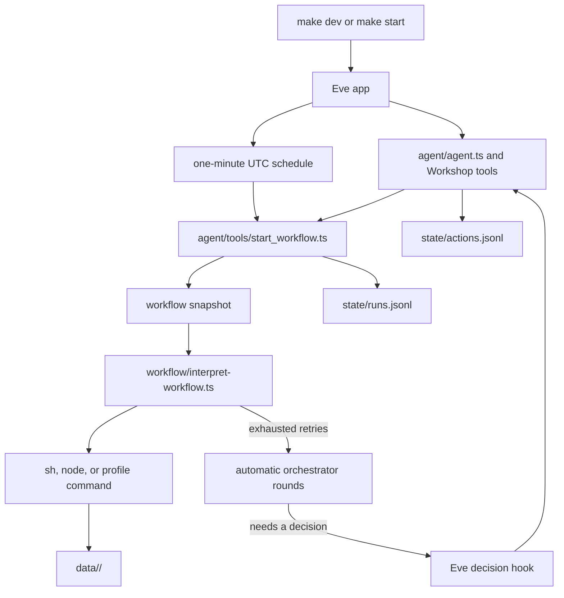

# Contributing

These rules keep the codebase easy to navigate and easy to delete from. The
first sections apply to any project; the last two sections record choices specific
to this one and how its code works.

## Naming files

A reader should know what a file does from its path alone, before opening it.

### Folders are nouns, files are verbs

- **Folders** name the domain things the code is about: `agent/`, `workflow/`, `run/`, and `schedule/`. Use the same nouns as the data model and user-facing terms.
- **Files** lead with a verb that says what they do: `workflow/load-workflows.ts`, `workflow/interpret-workflow.ts`, `run/read-run-index.ts`. A noun alone (`types.ts`) says what a file is about, not what it does.
- **Exception: pure shape.** A file that only declares types or a schema keeps a noun name, such as `workflow/types.ts` or `run/types.ts`. So does an entrypoint (`agent/agent.ts`) and a command tool (`agent/tools/list_runs.ts`).

### Use one verb per kind of work

Give each verb one meaning and reuse it for that meaning:

| Verb | Means | Example |
| --- | --- | --- |
| `parse` | turn text into structure | `workflow/parse-workflow-decision.ts` |
| `check` | apply fixed rules and report errors | `scripts/check-workflows.ts` |
| `load` | read a file and return checked data | `workflow/load-workflows.ts` |
| `build` | assemble input for another program | `workflow/build-orchestrator-brief.ts` |
| `create` | make a new snapshot | `workflow/create-workflow-snapshot.ts` |
| `execute` | carry out a unit of work | `agent/lib/execute-workflow-process.ts` |
| `locate` | find a state file | `run/locate-blocked-step.ts` |
| `record` | append an action record | `run/record-action-log.ts` |
| `read` | read stored records | `run/read-run-index.ts` |

Other plain verbs (`start`, `send`, `cancel`, `pause`, `resume`) are fine when no verb above already covers the job. Before adding a verb, check that it does not overlap one in the table; if it will recur, add it to the table.

### Rules that prevent collisions

- **Never use "run" as a verb.** In a workflow runner, `run` names one execution. A function named `runWorkflow` or a file named `run-paths.ts` forces the reader to guess which meaning you meant. Use `execute`, `advance`, `start`, or a more specific verb.
- **Use `parse` and `check` for different jobs.** Parsing turns input into structure. Checking applies fixed rules and reports errors.
- **Use the project's domain words.** Authors and code both call these items steps (`WorkflowStep`), not nodes.
- **Name the logic, not the area.** `run/read-run-index.ts` says what it reads; a broad name like `run/state.ts` does not.
- **Match exported symbols to the file's verb.** `workflow/load-workflows.ts` exports `loadWorkflows`; `run/locate-blocked-step.ts` exports `locateBlockedStep`.
- **Split a file when its name needs "and".** `read-and-remove.ts` is the ceiling: two steps that always happen together. Three verbs means three files.

## Code

- **Optimize for deletion.** Keep behavior local. Prefer a small duplicated helper over a shared abstraction that couples two features.
- **Point dependencies one way.** Entry points depend on domain folders, and domain folders depend on storage and utilities. Never the reverse. When a rule matters, write a test that reads the import graph and fails on a violation.
- **Comment the why.** Explain non-obvious reasons and constraints. Do not narrate what the next line does.
- **Test behavior that could regress.** Test what the code promises: its outputs, state transitions, and error cases. Do not test how it is built.

## Changes

- Keep each change small and about one thing. A rename and a behavior change belong in separate commits.
- Write commit subjects that say what changed and why; put the reasoning a reviewer needs in the body.
- Run the typecheck and tests before asking for review.

## This project

- A **workflow** is a folder of settings and ordered steps. A **run** is one execution of that workflow. A **step** is a command or an agent operation.
- Eve owns durable workflow execution. Workshop loads workflow folders, interprets steps, starts scheduled work, and exposes the orchestrator tools.
- `make check` validates local config and workflow folders, typechecks the project, and runs its tests.
- Before review, run:

  ```fish
  npx tsc --noEmit
  npm test
  make check
  npx eve build
  ```

- [Code map](#code-map) describes the folders and their boundaries; update it when you add or move a file.

## How the code works

Workshop is a Node.js and TypeScript application built on Eve. `make dev` starts Eve's development server; `make start` builds the app and starts its local service. Eve owns the schedule, chat session, and durable workflow execution.

The configured orchestrator profile powers chat through an Eve model adapter. Eve exposes Workshop's tools for listing workflows and runs, reading runs, starting or cancelling work, deciding blocked steps, pausing or resuming workflows, and reading actions. A one-minute UTC schedule checks each workflow and starts its latest due slot.

A workflow start records admission, copies the source folder into a run snapshot, and interprets its numbered steps in order. Command steps run with `sh` or `node`; agent steps and Markdown checks run through a configured profile command. Accepted output becomes the next step's stdin or is appended to the next agent prompt under `Input`. Checks and retries apply before the automatic orchestrator rounds. A run waits on an Eve hook when chat must decide what happens next.

Steps share the persistent `data/<workflow>/` folder. Workshop keeps a run index, action log, pause list, and blocked-step records under `state/`; Eve owns the durable execution state. Commands and agent profiles run with the user's permissions. They are not sandboxed, and an interrupted external action can repeat.



### Code map

Folders and filenames follow [Naming files](#naming-files).

```text
agent/                         Eve application and Workshop chat integration
├─ agent.ts                    configured profile as Eve's chat model
├─ instructions.md             orchestrator rules and first-message routine
├─ channels/eve.ts             local-request authentication
├─ lib/                        config, profile model, child process, hook decisions
├─ schedules/                  one-minute workflow scheduler
└─ tools/                      chat tools for runs, decisions, pause, and actions
workflow/                      workflow parsing, snapshots, interpretation, and retries
run/                           run index, blocked-step records, and action log
schedule/                      latest due cron-slot selection
scripts/                       config/workflow checks, private copy, launch-agent setup
service/                       launch-agent plist template
test/                          v2 tests and fake profile fixtures
examples/workflows/             hemingway-clock and daily-summary folders
workflows/                      private workflows; upstream keeps .gitkeep only
workshop.example.yaml           config template
workshop.yaml                   local config, ignored upstream
Makefile                        setup, checks, service, and copy commands
```

`agent/` contains Eve entry points. The workflow parser and interpreter stay in `workflow/` and do not depend on chat tools. `run/` and `schedule/` hold file-backed records and slot rules. `test/` uses fake profile commands so the suite does not need model credentials.

### Tests and validation

`npm test` runs the Node test suite in `test/`. `make check` validates config and workflows, then runs the typecheck and tests. `npx eve build` checks the Eve app bundle.
