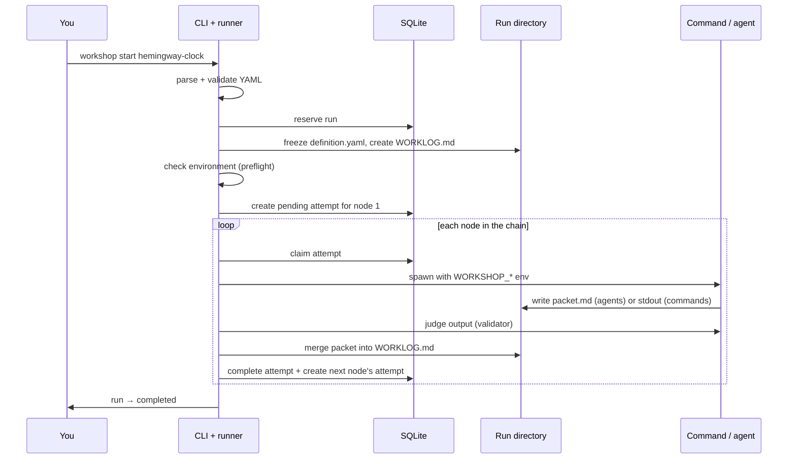

# Workshop

Workshop runs agent workflows on your machine, once or on a schedule, and
survives crashes while it does.

A workflow is a YAML file that describes a **chain of steps** (nodes). Each node
runs either a shell command or an AI agent (Pi, Claude Code, OpenCode, …). Each
node's output feeds the next node. An optional validator checks each result
before the chain moves on.

Three things hold all the state:

| Piece | Holds | Who writes it |
| --- | --- | --- |
| Workflow YAML | what to do | you |
| SQLite (`workshop.db`) | where every run stands: status, attempts, owners | the runtime only |
| `WORKLOG.md` (one per run) | what happened, in prose, for agents and humans | the runtime only; agents write their own packet file |

The runtime moves normal work forward without any model. It calls an
**orchestrator** agent only when an attempt fails and someone must judge what
to do next.

## A workflow

The bundled example, trimmed
([full file](examples/workflows/hemingway-clock.yaml)):

```yaml
id: hemingway-clock
schedule: { every: 10m, max_runs: 6 }   # omit for a one-shot workflow

defaults:
  max_attempts: 2
  agent:
    harness:
      command: 'pi --print --model "$WORKSHOP_MODEL_WITH_THINKING" -- "$(cat "$WORKSHOP_PROMPT_FILE")"'
    model: "openai-codex/gpt-5.3-codex:medium"

nodes:
  node-timestamp:                       # 1. shell command
    run: { command: "date -u +%FT%TZ" }
    validator: { command: 'test -n "$(cat "$WORKSHOP_NODE_OUTPUT_FILE")"' }
    next: node-generate-line

  node-generate-line:                   # 2. AI agent, checked by a second agent
    run:
      agent:
        instructions: Generate one original Hemingway-inspired sentence …
    validator:
      agent:
        instructions: Pass only if the output is one original sentence …
    next: node-append-quote

  node-append-quote:                    # 3. shell command, consumes node 2's output
    run:
      command: cat "$WORKSHOP_PREVIOUS_OUTPUT_FILE" >> hemingway.quotes.md
    max_attempts: 1                     # appending twice would duplicate the quote
    next: null
```

## What happens when you run it

`workshop start hemingway-clock` runs the whole chain in the foreground:



Step by step:

1. **Load.** `definition/` parses the YAML strictly, checks it with a Zod
   schema, and confirms the nodes form one linear chain.
2. **Create the run.** `run/create-run.ts` adds the run row to SQLite, then writes a frozen
   copy of the YAML and an empty worklog into the run directory. The run uses
   the frozen copy from here on, so editing the YAML mid-run changes nothing.
   A second `start` while a run is open does nothing.
3. **Check the environment.** `run/check-environment.ts` executes the optional
   `environment.preflight` command (here, `command -v pi`), which must exit 0.
   Workshop caches a pass per definition hash.
4. **Advance the chain.** `run/advance-chain.ts` loops. For each pending attempt,
   `attempt/execute-attempt.ts` does the work described in the next section.
5. **Finish.** When the last node completes, the run completes. The final
   output sits in the worklog under `<workflow-output>`.

### One attempt, up close

Each node execution is an **attempt**. `attempt/execute-attempt.ts` takes it through a
fixed sequence:

1. **Claim** the attempt in SQLite, which issues an owner token. Only the
   token's holder may change the attempt, so two runners never overlap.
2. **Prepare** `packet.md`, a scaffold with headings and one marker pair. For
   an agent, render `prompt`: the node's instructions plus the contract (read
   the worklog, write only your packet, put your handoff between the markers).
3. **Spawn** the command or harness in its own process group, with these
   variables:

   | Variable | Meaning |
   | --- | --- |
   | `WORKSHOP_PROMPT_FILE` | the rendered prompt (agents) |
   | `WORKSHOP_NODE_PACKET_FILE` | the one file an agent may write |
   | `WORKSHOP_PREVIOUS_OUTPUT_FILE` | the previous node's output |
   | `WORKSHOP_NODE_OUTPUT_FILE` | this node's extracted output (validators read it) |
   | `WORKSHOP_WORKLOG_FILE` | the run's worklog, read-only |
   | `WORKSHOP_MODEL`, `WORKSHOP_THINKING`, … | the resolved model, split several ways |
   | `WORKSHOP_CLI` | lets an agent call `runtime progress` or `runtime block` |

4. **Check integrity.** An agent must leave the worklog untouched and its
   packet well-formed, marker pair included.
5. **Extract output.** A command's output is its stdout. An agent's output is
   the text between `<next-node-output id="…">` markers in its packet (or
   `<workflow-output>` on the last node).
6. **Judge**, if the node has a `validator:`. A command validator passes on
   exit 0; an agent validator writes `validation.json` with `{"passed": …}`.
7. **Merge** the packet into `WORKLOG.md` under a file lock, and write a
   receipt so a repeated merge does nothing.
8. **Complete** the attempt and create the next node's pending attempt in one
   SQLite transaction.

Attempt states: `pending → running → finishing → completed`, or `failed`,
`blocked`, `cancelled`.

### When something fails

A timeout, a non-zero exit, a broken packet, or a validator rejection fails the
attempt and marks the run as needing judgment. Workshop then starts a fresh
orchestrator agent. It reads the worklog and the failed attempt's evidence,
then writes one decision to `result.json`:

- `retry` creates a new attempt for the same node, up to `max_attempts`.
- `block` pauses the run until you fix something and run `workshop resume`.
- `fail` ends the run.

Workshop records the decision in the worklog's "Global decision log" and
applies it. A crash needs no judgment: recovery confirms the old process is
dead and retries the attempt deterministically.

### Recurring workflows: the daemon

`start` runs only the first occurrence. For a `schedule:`, run the guardian in
another terminal:

```bash
bun src/cli/main.ts orchestrate
```

`daemon/reconcile-loop.ts` is a single process that polls SQLite once a second. Each tick it:

1. recovers interrupted work (`run/recover-after-crash.ts`),
2. creates due occurrences, one open run per workflow (`daemon/create-due-runs.ts`),
3. creates first attempts for queued runs,
4. runs pending orchestrator judgments,
5. launches pending attempts within `max_concurrent_runs`, through the same
   `advanceChain` the CLI uses.

## What lands on disk

```text
.workshop/                          machine-local, gitignored
├─ config/
│  ├─ workshop.yaml                 machine defaults (optional)
│  └─ workflows/<id>.yaml           your workflows
└─ state/
   ├─ workshop.db                   SQLite: workflows, runs, node_attempts
   └─ runs/<run-id>/
      ├─ definition.yaml            frozen YAML
      ├─ WORKLOG.md                 the run's shared log
      ├─ nodes/002-node-generate-line/attempt-001/
      │  ├─ prompt  packet.md  stdout  stderr  output
      │  ├─ validation/             validator prompt, logs, verdict
      │  └─ merge-receipt.json
      └─ orchestrator/<token>/      prompt.md  result.json  logs
```

## Code map

Folders follow the domain nouns: a **workflow** definition, a **run** of it,
and each **attempt** at a node. Filenames lead with a verb that says what the
file does; `CONTRIBUTING.md` lists the verbs.

```text
src/
├─ cli/                  command groups; main.ts dispatches the selected engine
│  ├─ dispatch-v4-command.ts isolated temporary v4 route
│  ├─ dispatch-v4-public-command.ts public socket-only v4 client
│  └─ watch-v4.ts          service-backed v4 viewer adapter
├─ load-installation.ts  find .workshop/ and read machine defaults
├─ definition/           v1 definitions plus v2 contracts
│  ├─ parse-yaml.ts            strict YAML: no duplicate keys or anchors
│  ├─ schema.ts                v1 Zod workflow and machine schemas
│  ├─ check-chain.ts           shared v1/v2 linear-chain policy
│  ├─ load-definition.ts       v1 file/snapshot loader
│  ├─ resolve-node-settings.ts v1 node → workflow → machine settings
│  ├─ parse-model.ts           v1 provider/model:thinking parser
│  ├─ hash-canonical-json.ts   canonical definition and exact source hashes
│  ├─ schema-v2.ts             v2 workflow and machine schemas
│  ├─ schema-resolved-v2.ts    frozen node and internal-judge settings
│  ├─ check-v2-definition.ts   strict v2 text/schema/topology check
│  ├─ parse-v2-model.ts        supported v2 thinking-level parser
│  ├─ resolve-v2-agent-settings.ts v2 site → workflow → machine resolution
│  └─ resolve-v2-workflow-settings.ts v2 workflow → machine resolution
├─ installation/         session-scoped installation index and service receipts
│  └─ schema-v2.ts             run references, activations, reservations, preflight cache, receipts
├─ run/                  one run, start to finish
│  ├─ schema-v2.ts             v2 outcomes, judgment decisions, failure/block states
│  ├─ records-v2.ts            canonical run document and immutable evidence contracts
│  ├─ prepare-admission-v2.ts  check frozen definition, settings, and paths
│  ├─ decide-fixed-rate-schedule.ts fixed-rate slots, deadlines, and skip decisions
│  ├─ create-run.ts            reserve a run, freeze its definition
│  ├─ check-environment.ts     preflight, cached per definition hash
│  ├─ start-run.ts             create, preflight, first attempt
│  ├─ advance-chain.ts         execute pending attempts until the chain ends
│  ├─ orchestrate-failure.ts   an agent decides: retry, block, or fail
│  └─ recover-after-crash.ts   reconcile work orphaned by a crash
├─ attempt/              one node, once
│  ├─ parse-v2-result.ts          strict worker-result and validator-verdict envelopes
│  ├─ render-v2-agent-prompt.ts   fresh worker and validator prompts
│  ├─ execute-attempt.ts          claim → spawn → check → judge → merge → complete
│  ├─ build-attempt-env.ts        the WORKSHOP_* variables
│  ├─ render-agent-prompt.ts      node instructions plus the packet contract
│  └─ judge-output.ts             the node's validator
├─ service/              owner lifecycle and private versioned Unix protocol
│  ├─ acquire-service-lock.ts    kernel flock with process identity metadata
│  ├─ locate-service-socket.ts   short private path for long installations
│  ├─ open-v2-service-runtime.ts Durable Harness handlers, reconciliation, and close
│  ├─ parse-service-protocol.ts  checks bounded v1 requests and responses
│  ├─ probe-service-health.ts    checks metadata against a live socket
│  ├─ project-v2-service-reads.ts status, bounded run pages, and logs
│  ├─ send-service-request.ts    correlated response reassembly and retry
│  ├─ serve-v2-service-process.ts service-only process lifecycle
│  ├─ serve-workshop-service.ts  acquire-before-open, request dispatch, bounded shutdown
│  └─ schema.ts                 strict service methods, requests, and responses
├─ daemon/               the `orchestrate` loop: schedules and recovery
├─ model/                checked owner Pi model catalog and private Tally auth
│  ├─ schema-owner-models.ts       checked owner configuration shapes
│  ├─ create-workshop-models.ts    public pi-ai provider registry
│  ├─ load-owner-models.ts         loads provider metadata without retaining keys
│  ├─ parse-owner-models.ts        compiles supported model descriptors
│  └─ resolve-owner-provider-auth.ts request-time credential resolution
├─ process/              launch, identify, and kill child processes
│  ├─ launch-process.ts  bounded capture, stream evidence, and process groups
│  └─ schema-v2.ts       typed incarnation, exit, cleanup, and capture evidence
├─ proof/                isolated Pi Durable Hemingway experiment; not the CLI runtime
├─ worklog/              the packet and marker protocol, merges into WORKLOG.md
├─ storage/
│  ├─ durable/                 production Durable SQLite ownership and record tokens
│  │  ├─ open-durable-storage.ts      verifies FULL synchronization before opening
│  │  ├─ define-workshop-records.ts   versioned documents and immutable entries
│  │  ├─ admit-run.ts                 atomic prepared-run admission and idempotency
│  │  ├─ define-scheduler-wakeup-task.ts durable fixed-rate scheduler and run admission
│  │  ├─ commit-service-mutation.ts   atomic mutation effects and response receipts
│  │  ├─ define-workshop-tasks.ts         Durable workflow and judgment orchestration
│  │  ├─ define-node-attempt-task.ts       worker/validator execution, replay, stop, settlement
│  │  ├─ define-process-execution-task.ts shared role-aware process supervision and capture
│  │  ├─ define-capacity-gate-task.ts     persisted capacity wait and slot acquisition
│  │  ├─ render-v2-worklog.ts             renders the canonical run as Markdown
│  │  └─ materialize-run-views.ts          rebuilds local files from committed run state
│  ├─ db/                      SQLite schema and every guarded transition
│  └─ disk/                    run-directory paths, crash-safe writes, locks
├─ views/                versioned JSON and human renderings of state
│  └─ schema-v2.ts       strict version-2 public DTOs for status, runs, details, logs
├─ tui/                  the `watch` terminal viewer (OpenTUI)
└─ util/                 clock, ids, hashing, unit parsing, shared v2 schemas
   ├─ parse-units.ts     bounded v1/v2 duration and byte-cap parsing
   └─ schema-v2.ts      UTC timestamps, SHA-256 values, and shared replay policy
```

Dependencies point one way: `cli/` and `daemon/` → `run/` → `attempt/` →
`definition/`, `worklog/`, `storage/`, and `process/`. `service/` uses `model/` to assemble native-judgment providers. Two rules keep it that way:

- `views/` is the contract for outside readers. `status --json` and
  `runs --json` have versioned shapes, and the viewer reads those, never SQLite
  or run directories.
- Only `tui/` imports a UI library; `cli/watch.ts` and `cli/watch-v4.ts` load
  it lazily. A test fails if runtime code imports it.

## Quick start

```bash
bun install
mkdir -p .workshop/config/workflows
cp examples/workflows/hemingway-clock.yaml .workshop/config/workflows/

bun src/cli/main.ts validate hemingway-clock
bun src/cli/main.ts start hemingway-clock
cat .workshop/state/runs/*/WORKLOG.md | tail -40
```

The example needs `pi` on your PATH. A successful run stamps the time, writes
and validates one sentence, and appends it to `hemingway.quotes.md`.

### Commands

| Command | Does |
| --- | --- |
| `start <id>` | start a run (and enable its schedule) |
| `pause` / `resume` / `stop <id>` | control the open run and its schedule |
| `status [<id>] [--json]` | tree of workflows, runs, nodes, attempts |
| `runs <id> [--json]` | occurrence history, newest first |
| `logs <id> [--follow \| --all]` | worklog and process logs |
| `watch [<id>]` | live TUI: `j`/`k` history, `f` follow, `a` all logs, `q` quit |
| `diagram <id> [--mermaid]` | the chain with live status |
| `node describe <id> <node>` | a node's resolved settings and status |
| `orchestrate` | the daemon |

Run any of them as `bun src/cli/main.ts <command>`.

### Experimental Durable-backed v4 fixture

The leading `--engine v4` selector remains opt-in; omitting it keeps the v3 CLI. To exercise the public v4 service without a live provider:

```fish
bun test tests/check-cli-engine-selector.test.ts tests/check-v2-service-restart.test.ts
```

The restart test creates a temporary installation and runs the deterministic Hemingway mock through `--engine v4 start`, `status`, `runs`, `logs`, and `node describe`. It restarts the service, checks the same Durable run, and removes the temporary installation. The mock needs no model credentials. These results come from the Durable-backed service, not v3 status data or the JSON printed by `src/proof/`.
The v4 inspector also supports `runs --all`, `logs --run`, `logs --follow`, `logs --all`, frozen `node describe --run`, `diagram --run --mermaid`, and `watch`. The v4 viewer reads service-backed projections, shows selected historical chains, and retains the picker, occurrence navigation, follow/collated worklogs, narrow-terminal layout, and clean quit. Human run times use the machine-local clock; JSON retains UTC timestamps.
V4 raw worker and validator streams retain a UTF-8-safe head/tail window after the process group retires. For successful command workers, semantic stdout is extracted before raw-file retention. `logs` reports total, retained, omitted, head, and tail byte counts. The cap applies to raw diagnostics, not extracted command output, and it is not a live disk quota. Use `stream_cap: unlimited` to opt out.

V4 native failure judgment compiles Tally-backed provider entries from `~/.pi/agent/models.json` (or `PI_CODING_AGENT_DIR/models.json`) through public `@earendil-works/pi-ai` APIs. It accepts the checked OpenAI Responses, OpenAI Completions, and Anthropic Messages adapters at their fixed Tally routes. Model entries need explicit pricing; entries without rates are omitted rather than assigned a zero cost. Credentials and the `X-Tally-User`/`X-Tally-Hostname` headers are resolved from the owner file for each auth operation; command credentials, custom auth headers, and non-Tally endpoints are rejected. Fake-fetch tests check request URLs, auth and attribution headers, and a synthetic streamed response. This proves SDK wiring only, not Gateway availability or real-model judgment; no live or paid request ran.

### V4 headless-agent command templates

Choose one command for each agent site; Workshop uses the same supervised process and strict result-file contract for every harness. The model names below are syntax examples, not available provider claims. Workshop passes the rendered prompt through `WORKSHOP_PROMPT_FILE` and names `WORKSHOP_RESULT_FILE` in that prompt. The harness must write the checked JSON result there; stdout remains diagnostic output.

```yaml
pi:
  model: example/pi-model:medium
  model_env: [WORKSHOP_MODEL_WITH_THINKING]
  prompt_env: WORKSHOP_PROMPT_FILE
  result_env: WORKSHOP_RESULT_FILE
  command: 'pi --print --approve --no-session --model "$WORKSHOP_MODEL_WITH_THINKING" -- "$(cat "$WORKSHOP_PROMPT_FILE")"'
opencode:
  model: example/opencode-model:medium
  model_env: [WORKSHOP_MODEL, WORKSHOP_THINKING]
  prompt_env: WORKSHOP_PROMPT_FILE
  result_env: WORKSHOP_RESULT_FILE
  command: 'opencode run --format json --auto --model "$WORKSHOP_MODEL" --variant "$WORKSHOP_THINKING" -- "$(cat "$WORKSHOP_PROMPT_FILE")"'
claude-code:
  model: example/claude-model:medium
  model_env: [WORKSHOP_MODEL_ID, WORKSHOP_THINKING]
  prompt_env: WORKSHOP_PROMPT_FILE
  result_env: WORKSHOP_RESULT_FILE
  command: 'claude --print --output-format text --permission-mode auto --no-session-persistence --model "$WORKSHOP_MODEL_ID" --effort "$WORKSHOP_THINKING" -- "$(cat "$WORKSHOP_PROMPT_FILE")"'
```

These shell flags have **not** been checked against installed Pi, OpenCode, or Claude Code binaries by the v4 tests. The automation checks the workflow contract and exercises two different mock harness mappings; it makes no vendor CLI or model call. Confirm each installed CLI's current flags and permission behavior before using a template. Approval/auto modes can grant broad project access; run only on a trusted machine.

## Configuration

`.workshop/config/workshop.yaml` holds machine defaults; every field is
optional:

```yaml
shell: /bin/bash
max_concurrent_runs: 1
default_timeout: 10m
stream_cap: 256kb     # per captured stream: bytes | kb | mb | unlimited
agent:
  model: "openai-codex/gpt-5.3-codex:medium"
```

Agent settings resolve field by field: node, then workflow `defaults`, then
machine. Models take the form `<provider>/<model-id>:<thinking-level>`.

Workshop caps raw stdout and stderr, since an agent's stdout can grow to
megabytes. It keeps the head and tail and records the original size in a
`<stream>.truncation.json` sidecar. It never truncates packets, outputs, or the
worklog. A node may set its own `stream_cap:`.

### Harnesses

Any CLI agent works if a shell command can launch it with a prompt file:

| Harness | Command |
| --- | --- |
| Pi 0.85 | `pi --print --mode json --approve --no-session --model "$WORKSHOP_MODEL_WITH_THINKING" -- "$(cat "$WORKSHOP_PROMPT_FILE")"` |
| OpenCode 1.18 | `opencode run --format json --auto --model "$WORKSHOP_MODEL" --variant "$WORKSHOP_THINKING" -- "$(cat "$WORKSHOP_PROMPT_FILE")"` |
| Claude Code 2.1 | `claude --print --output-format text --permission-mode auto --no-session-persistence --model "$WORKSHOP_MODEL_ID" --effort "$WORKSHOP_THINKING" -- "$(cat "$WORKSHOP_PROMPT_FILE")"` |

These are legacy v1 templates. Their listed versions and flags are historical examples, not verified v4 support; check current CLI behavior before use. Approval modes can grant broad tool access, so run only on a trusted machine.

## Scope and status

Workshop is a proof of concept for trusted, local workflows. It runs with your
permissions and has no sandbox, no untrusted input, no branching graphs, and
no budgets. Starting a workflow authorizes every command and agent in it.
Automatic retry assumes a node is safe to repeat; set `max_attempts: 1` when it
is not.

| Stage | Proves | Status |
| --- | --- | --- |
| POC-A | runtime: durable chain, worklog, SQLite, validators, recovery | done |
| POC-B | status viewer over the CLI projections | done |
| POC-C | `$build-workflow` authoring skill | next |
| POC-D | notification channels | later |

## V4: Pi Durable proof

The public CLI still uses v3. The proposed replacement uses Pi Durable for
Workshop's task execution and one subprocess interface for every command,
headless agent, and validator. Read the implementation contract in
[workshop-spec-v4.md](.agents/dox/workshop-spec-v4.md).

The isolated proof uses real Durable SQLite storage and launches a mock agent
in a separate process. It checks result JSON, publishes one quote file per run,
and preserves the same run on reopen:

```fish
set proof .workshop/state/proofs/hemingway/mock-(date +%s)
bun src/proof/prove-hemingway.ts --state-dir $proof
bun src/proof/prove-hemingway.ts --state-dir $proof
bun test tests/proof/
```

Use a new state directory for a new run. Add `--pause-after timestamp` to
close at a committed boundary, then reopen without that flag. To use real Pi
with its configured default model and credentials:

```fish
set real .workshop/state/proofs/hemingway/real-(date +%s)
bun src/proof/prove-hemingway.ts --state-dir $real \
  --agent-command 'pi --print --approve --no-session --tools write -- "$(cat "$WORKSHOP_PROMPT_FILE")"'
```

The quoted agent command is a Bash template executed by the proof, not fish.
The proof archives inside its own state directory; it leaves existing quotes
and v3 state untouched. Tests cover actual reopen/crash/stop behavior, whole
process-group cleanup, strict result checking, and upstream SQLite storage
conformance under Bun with FULL synchronization.

This is not the full v4 service: no workflow YAML loading, recurrence, semantic
agent validator, or native failure judge yet. Its scratch-directory lock is
not a production service ownership protocol. The spec names the remaining
gates and proof limitations.

## Development

```bash
bun test          # acceptance tests against a mock harness (tests/mock/harness.ts)
bunx tsc --noEmit # typecheck
```

The real-model path has one manual check: the quick start above. Read
`CONTRIBUTING.md` before adding or renaming a file.

- Current spec: `.agents/dox/workshop-spec-v3.md`
- Proposed v4: `.agents/dox/workshop-spec-v4.md`
- Build history and bug log: `.agents/dox/2026-09-10-workshop-execution.md`
