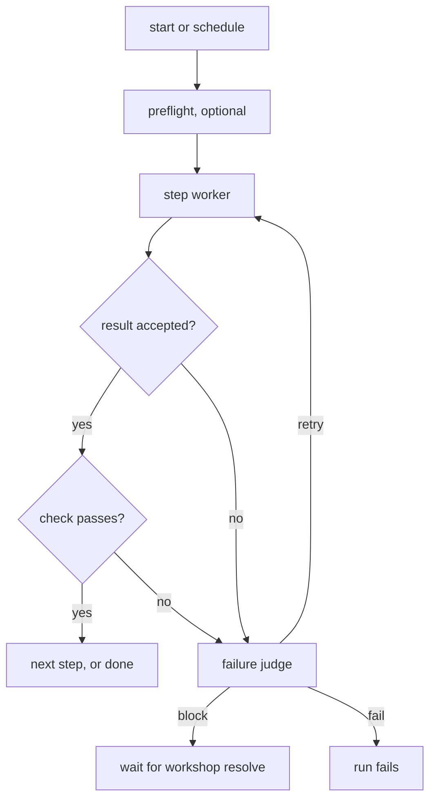

# Workshop

Workshop runs agent workflows on your machine, once or on a schedule, and
survives crashes while it does.

A workflow is a YAML file that lists a **chain of steps**. Each step runs
either a shell command or a headless AI agent (Pi, Claude Code, OpenCode, …).
Each step's output feeds the next step, and an optional check validates each
result before the chain moves on. Normal progress never needs a model. A
built-in judge model is asked only when an attempt fails.

## Quick start

Workshop keeps its config and state in a `.workshop/` directory inside whatever
project you run it from.

```bash
alias workshop="bun $PWD/src/cli/main.ts"   # run from this repo after `bun install`

mkdir -p ~/scratch/hemingway/.workshop/workflows && cd ~/scratch/hemingway
cp $OLDPWD/examples/workshop.yaml .workshop/
cp $OLDPWD/examples/workflows/hemingway-*.yaml .workshop/workflows/
```

Edit `.workshop/workshop.yaml` before the first run. Its models are
placeholders: set `agent.model` to a model your Pi installation can use, and
`orchestrator.model` to a priced model from `~/.pi/agent/models.json` (see
[The failure judge](#the-failure-judge)).

### Watch it work

`hemingway-judge` is the most instructive example. Its first attempt at the
timestamp step is rigged to fail, so you see the judge decide a retry. One run
makes about three agent calls and one judge call.

```bash
workshop validate hemingway-judge          # offline YAML and settings check
workshop start hemingway-judge --detach    # starts the service, prints the run id
workshop watch hemingway-judge             # live viewer; q quits
```

When the run finishes, inspect what happened:

```bash
workshop status                                     # every workflow and its schedule
workshop diagram hemingway-judge                    # the chain with step status
workshop step describe hemingway-judge timestamp    # attempt 1 rejected, judge said retry
workshop logs hemingway-judge                       # worklog plus every kept process capture
cat .workshop/archive/hemingway-judge/*.md          # the published sentence
workshop service stop
```

To see crash recovery, run `workshop start hemingway-clock --detach`. While
`generate-line` is running, find the service pid with
`workshop service status` and `kill -9` it. The next `workshop status` starts a
new service, which retires the orphaned process group before doing anything
else. That step says `replay: safe`, so it then runs again on its own. A step
without `replay: safe` would block until you decide with `workshop resolve`.
The example schedules six runs ten minutes apart; `workshop stop
hemingway-clock` ends the schedule.

## How it works

You drive Workshop through its CLI. Behind it, one background service per
project owns all state and runs your schedules. It keeps going after `start`
returns, until `workshop service stop`. The service records each step before it
takes the next action, so after a crash or reboot a run resumes where it stopped.

A run walks the chain one step at a time:



Each process gets a folder with its inputs, prompt, result, and any stdout or
stderr. A completed run deletes its folder; failed, blocked, and stopped runs
keep theirs. `workshop logs` renders the run's story from the database. When
`max_concurrent_runs` runs are already going, a new run waits for a slot.

### Things that are easy to get wrong

- **There are two kinds of model call.**
  - Workers and agent checks run a harness command (`pi --print …` by
    default) as ordinary subprocesses, so any headless agent can replace `pi`.
  - Only the failure judge is a direct model call. Its model comes from
    `~/.pi/agent/models.json` through Tally, and it can only record one
    decision.
- **The definition freezes when the run is admitted.** Editing the YAML
  mid-run changes nothing; the next run picks it up.
- **Replay is opt-in per step.** After a crash, a step marked `replay: safe`
  reruns. Anything else blocks, because the service cannot prove the process
  had no side effects yet.
- **A retry needs more than `max_attempts`.** The judge may choose retry only
  when the step, and its check if there is one, are both `replay: safe`
  and attempts remain. Otherwise it can only block or fail.
- **The service owns the state.** Every command, `watch` included, asks the
  service instead of reading files. `status --json` is the stable,
  machine-readable view.
- **Agent stdout is not the output.** An agent step succeeds only by writing
  checked JSON to `WORKSHOP_RESULT_FILE`. For command steps, stdout is the
  output.
- **A blocked run stalls its schedule.** Slots that come due while a run is
  unresolved are skipped. After service downtime, only the latest missed slot
  runs.

To see how the code is structured, see
[CONTRIBUTING](CONTRIBUTING.md#how-the-code-works).

## A workflow

The bundled example, trimmed
([full file](examples/workflows/hemingway-clock.yaml)):

Save it as `.workshop/workflows/hemingway-clock.yaml`; the file name is the
workflow id.

```yaml
schedule: { every: 10m, max_runs: 6 }   # omit for a one-shot workflow
defaults:
  max_attempts: 2
  replay: safe                          # steps rerun after a crash; the default is never

steps:
  - timestamp: date -u +%FT%TZ          # 1. shell command
  - generate-line:                      # 2. AI agent, checked by a second agent
      agent: Generate one original Hemingway-inspired sentence …
      check: Pass only if it is one original sentence …
  - publish-quote:                      # 3. shell command, consumes step 2's output
      run: cp "$WORKSHOP_PREVIOUS_OUTPUT_FILE" "$WORKSHOP_ARCHIVE/$WORKSHOP_RUN_ID.md"
      max_attempts: 1
```

A step is a command string, `run: <command>`, or `agent: <instructions>` (or
`agent: { instructions, model, harness }`), plus optional `check`,
`max_attempts`, `timeout`, `stream_cap`, and `replay`. A string `check` is the
same kind as its step; write `check: { run: … }` or `check: { agent: … }` to
mix kinds, with optional `timeout` and `replay`. An agent check uses the
workflow and machine agent settings, not its step's.

Commands produce their output on stdout. Agents get their prompt in
`WORKSHOP_PROMPT_FILE` and must write checked JSON to `WORKSHOP_RESULT_FILE`;
their stdout is diagnostic only. Every process also sees:

| Variable | Holds |
| --- | --- |
| `WORKSHOP_RUN_ID`, `WORKSHOP_WORKFLOW_ID` | the run and workflow |
| `WORKSHOP_STEP_ID`, `WORKSHOP_ATTEMPT` | the step and its attempt number |
| `WORKSHOP_PREVIOUS_OUTPUT_FILE` | the previous step's output |
| `WORKSHOP_STEP_OUTPUT_FILE` | the candidate output, for a check |
| `WORKSHOP_WORKLOG_FILE` | the compact run log at launch |
| `WORKSHOP_ARCHIVE` | `.workshop/archive/<workflow>/`, kept across runs |

An optional `environment.preflight` command runs before the first step and
sees the run, workflow, and archive variables.

## Commands

| Command | Does |
| --- | --- |
| `validate <id>` | check YAML and resolved settings, offline |
| `start <id> [--detach]` | admit a run (and enable its schedule); wait unless detached |
| `pause` / `resume` / `stop <id>` | control the open run and its schedule |
| `resolve <id> --action retry\|accept\|fail --reason <text>` | decide a blocked run |
| `status [<id>] [--json]` | workflows, activations, and each unresolved run |
| `runs <id> [--json] [--all]` | run history, newest first |
| `logs <id> [--run <id>] [--follow \| --all] [--json \| --verbose]` | worklog and kept process captures; `--verbose` adds hashes and settings |
| `watch [<id>]` | live TUI: `j`/`k` history, `f` follow, `a` all logs, `q` quit |
| `diagram <id> [--run <id>] [--mermaid]` | the chain with run status |
| `step describe <id> <step> [--run <id>] [--json]` | frozen settings and attempt evidence |
| `service start` | start the detached service; does nothing if it is running |
| `service serve` | run the service in the foreground |
| `service status [--json]` | health, PID, and boot ID; exit 3 when not running |
| `service stop` | graceful shutdown; does nothing if it is not running |

Run any of them as `bun src/cli/main.ts <command>`; `help` lists them. Any
command that needs the service starts it. The service keeps running schedules
after `start` returns, until `service stop`.

Exit codes: 0 success, 1 failed or cancelled run, 2 blocked run, 3 service
unavailable, 64 usage or configuration error.

`service stop` signals only a process it can verify as this project's service,
then waits up to 15 s for it to exit. If it cannot verify the process, it exits
3 without signaling anything.

## Configuration

`.workshop/workshop.yaml` holds optional machine defaults
([example](examples/workshop.yaml)):

```yaml
shell: /bin/bash
max_concurrent_runs: 1
default_timeout: 10m
stream_cap: 256kb     # per captured stream: bytes | kb | mb | unlimited
keep_files: failed    # failed: delete a completed run's folder | always: keep it
agent:
  model: "example/pi-model:medium"
orchestrator:
  model: "example/judge-model:low"
```

Agent settings resolve field by field: step, then workflow `defaults`, then
machine. Models take the form `<provider>/<model-id>:<thinking-level>`; there
is no default model. The harness defaults to `pi`, the first template below.
`project_dir` resolves relative to `.workshop/`.

Neither file needs a `version`. If one is present it must be `3`; older
formats fail with a message naming the change.

### Headless-agent command templates

Set `harness: pi` (the default) or `harness: { command: … }` for each agent; Workshop uses the same supervised process and strict result-file contract for every harness. The model names below are syntax examples, not available provider claims. Workshop passes the rendered prompt through `WORKSHOP_PROMPT_FILE` and names `WORKSHOP_RESULT_FILE` in that prompt. The harness must write the checked JSON result there; stdout remains diagnostic output.

```yaml
pi:
  model: example/pi-model:medium
  model_env: [WORKSHOP_MODEL_WITH_THINKING]
  prompt_env: WORKSHOP_PROMPT_FILE
  result_env: WORKSHOP_RESULT_FILE
  command: 'pi --print --approve --no-session --no-extensions --no-skills --no-context-files --no-mcp --model "$WORKSHOP_MODEL_WITH_THINKING" -- "$(cat "$WORKSHOP_PROMPT_FILE")"'
opencode:
  model: example/opencode-model:medium
  model_env: [WORKSHOP_MODEL, WORKSHOP_THINKING]
  prompt_env: WORKSHOP_PROMPT_FILE
  result_env: WORKSHOP_RESULT_FILE
  command: 'opencode run --format json --auto --model "$WORKSHOP_MODEL" --variant "$WORKSHOP_THINKING" -- "$(cat "$WORKSHOP_PROMPT_FILE")"'
claude-code:
  model: example/claude-model:medium
  model_env: [WORKSHOP_MODEL_ID, WORKSHOP_THINKING]
  prompt_env: WORKSHOP_PROMPT_FILE
  result_env: WORKSHOP_RESULT_FILE
  command: 'claude --print --output-format text --permission-mode auto --no-session-persistence --model "$WORKSHOP_MODEL_ID" --effort "$WORKSHOP_THINKING" -- "$(cat "$WORKSHOP_PROMPT_FILE")"'
```

The Pi template ran against Pi 1.1.0 in a live smoke test. The OpenCode and
Claude Code flags have not been checked against installed binaries; confirm
them before use. Approval and auto modes can grant broad project access, so
run them only on a trusted machine.

### The failure judge

The judge does not go through a harness. Workshop calls `orchestrator.model`
directly, using its Tally-backed entry in `~/.pi/agent/models.json` (or
`PI_CODING_AGENT_DIR/models.json`). The entry needs explicit pricing;
entries without rates are left out rather than assigned zero cost. Credentials
and Tally attribution headers are read from the owner file at request time and
never stored. Command credentials, custom auth headers, and non-Tally endpoints
are rejected.

### Worker processes

Workers, checks, and preflight run as `<shell> -lc '<command>'` in their
own process group. The login flag sources your shell profile, so anything the
profile prints to stderr shows up in every process's stderr capture.

Raw stdout and stderr keep a UTF-8-safe head and tail window of `stream_cap`
bytes each; `logs` reports total, retained, and omitted byte counts. A command
step's output is saved before the cap applies.

## What lands on disk

```text
.workshop/                          machine-local, gitignored
├─ workshop.yaml                    machine defaults, optional
├─ workflows/<id>.yaml              your workflows
├─ archive/<workflow>/              WORKSHOP_ARCHIVE, kept across runs
└─ state/
   ├─ durable.db                    run database, owned by the service
   ├─ service.json  service.lock  service.sock
   └─ runs/<workflow>-<uuid>/       deleted on completion unless keep_files: always
      ├─ preflight/                 preflight.stdout, preflight.stderr
      └─ <step>.<attempt>/
         ├─ previous-output.txt     predecessor output, empty for the first step
         ├─ candidate-output.txt    the worker's candidate, for the check
         ├─ worklog.md              compact run log at launch
         └─ <role>.prompt.md  <role>.result.json  <role>.stdout  <role>.stderr
```

`<role>` is `worker` or `validator` (the check). A safe replay adds the incarnation
number, as in `worker.2.stdout`. Empty stdout and stderr files are removed.

Workflows may write anywhere. The Hemingway examples publish one
`<run-id>.md` per run to their archive.

## Status and limitations

Workshop is a proof of concept for trusted, local workflows. It runs with your
permissions and has no sandbox, no untrusted input, no branching graphs, and
no budgets. Starting a workflow authorizes every command and agent in it.

| Stage | Proves | Status |
| --- | --- | --- |
| POC-A | runtime: durable chain, worklog, SQLite, checks, recovery | done |
| POC-B | status viewer over the CLI projections | done |
| Service | background service on Pi Durable with crash recovery | done |
| POC-C | `$build-workflow` authoring skill | next |
| POC-D | notification channels | later |

Known limitations:

- Tested on macOS only. The service loads a native SQLite binding and refuses
  to start if that binding cannot load; Linux (glibc and musl) is untested.
- No upgrade migration. Each run records the task versions it started with.
  If a later release changes a task version incompatibly, the old run blocks
  instead of guessing. Finish or stop runs before upgrading.
- `service start` discards the service's stdout and stderr, so a failed
  startup shows only the CLI error. Run `workshop service serve` to see the
  cause.

## Contributing

See [CONTRIBUTING](CONTRIBUTING.md) for conventions, checks, and how the code
works.
